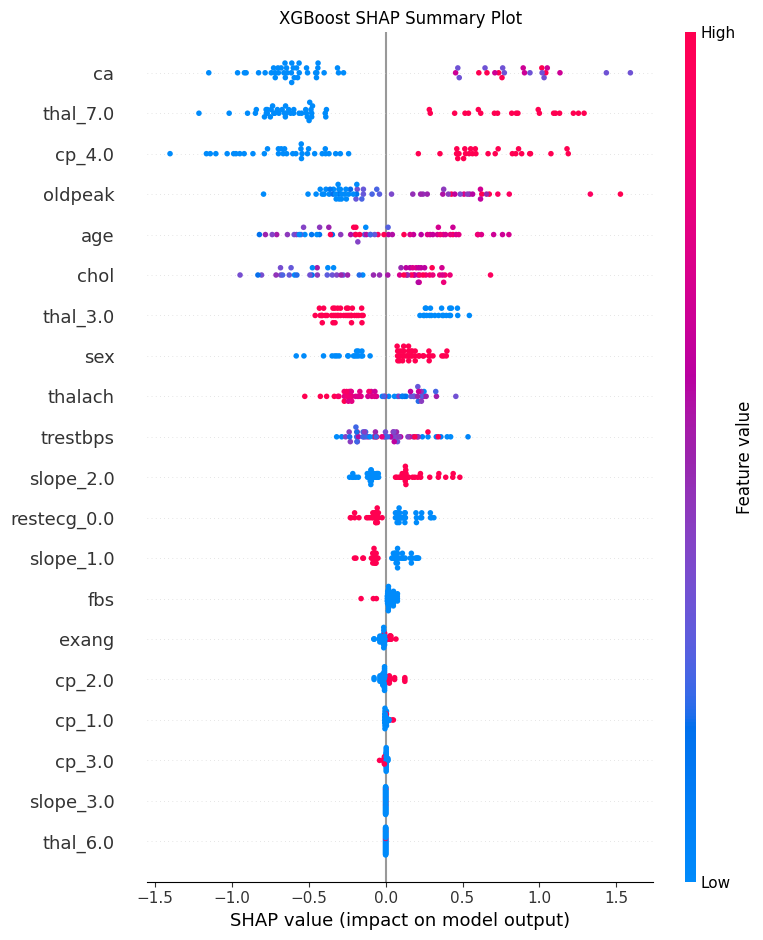
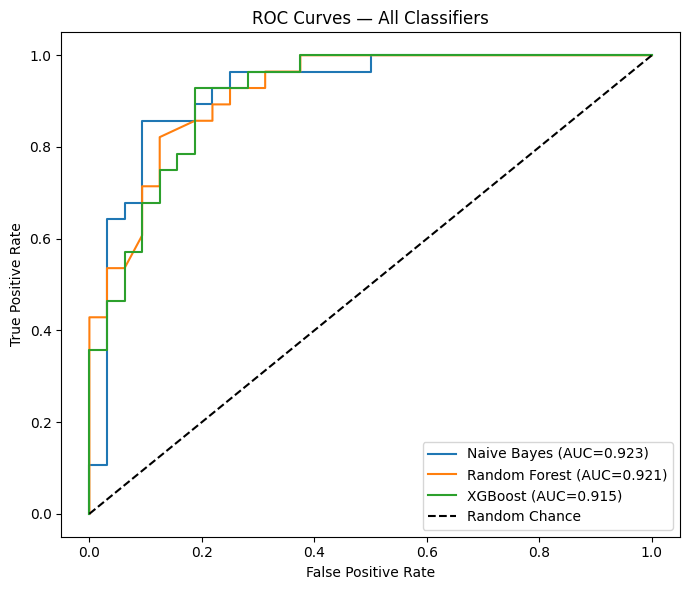
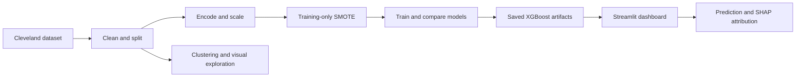

<div align="center">

# 💓 CardioAI

### Heart Disease Prediction & Explainable Machine Learning

From patient data to model insights: a machine learning portfolio featuring a Streamlit dashboard, XGBoost predictions, and SHAP explanations.


[Explore the analysis](notebook/i232634_DS-A_Assignment%204_Notebook.ipynb) · [Read the report](report/i232634_DM_Assignment_4_Report.pdf) · [Run locally](#run-the-dashboard) · [Work with me](#work-with-me)

</div>

---

## The project

How can a prediction become easier to inspect and understand? CardioAI connects data preparation, model comparison, and feature attribution with an interactive interface. Built on the UCI Cleveland Heart Disease dataset, it demonstrates the path from exploratory analysis to a working application prototype.

Originally developed for a university data mining assignment, this project showcases practical skills in **tabular machine learning, explainable AI, experiment reporting, and dashboard development**. A separate MNIST experiment extends the notebook into computer vision.

## What you can explore

| Capability | Implementation |
| :--- | :--- |
| **Interactive predictions** | Streamlit form with 13 patient attributes, a predicted class, and a model probability score |
| **Explainable outputs** | SHAP summary analysis and the dashboard's three largest absolute feature contributions |
| **Model benchmarking** | Naive Bayes, Random Forest, XGBoost, single-layer perceptron, and MLP |
| **Patient segmentation** | K-Means, hierarchical clustering, PCA, and t-SNE visualizations |
| **Neural network experiments** | Architecture comparisons, training curves, and an MLP ablation study |
| **Computer vision extension** | MNIST CNN, learned filters, feature maps, and an MLP baseline |
| **Reviewable deliverables** | Executed notebook, PDF report, dashboard source, and saved model artifacts |

## A look inside the analysis

### Which features influence the model?



SHAP attribution makes model behavior inspectable across the dataset. The dashboard also displays the three largest absolute contributions for an individual input; magnitude alone does not indicate whether a feature raises or lowers the prediction.

### How do the classifiers compare?



Both charts are original outputs extracted from the committed notebook.

## Recorded results

The values below come from the notebook's saved **Final Results Summary**, rather than a new training run.

| Heart disease model | Test accuracy | ROC AUC |
| :--- | ---: | ---: |
| **Single-layer perceptron** | **90.00%** | **0.9420** |
| Naive Bayes | 86.67% | 0.9230 |
| Multi-layer perceptron | 83.33% | 0.9375 |
| Random Forest | 81.67% | 0.9208 |
| XGBoost | 80.00% | 0.9152 |

The dashboard uses the saved **XGBoost** artifact. The perceptron achieved the highest recorded accuracy and AUC in this experiment.

**Evaluation context:** 303 original records, 297 after removing missing values, and a stratified split of 237 training / 60 test records. The notebook encodes inputs into 22 features, fits the scaler on the training data, and applies SMOTE to the training split only, producing 256 training records. Cross-validation is performed on that resampled training set, so fold scores should be interpreted with that limitation.

**Separate computer vision experiment:** the MNIST CNN recorded **98.00%** test accuracy versus **91.50%** for its MLP baseline, on a 2,000-image test subset. These are digit classification results, separate from the heart disease task.

## How it fits together



## Run the dashboard

Use a Python environment compatible with the dependencies in `app/requirements.txt`. The saved artifacts are included, so retraining and the raw dataset are not required to launch the app.

```bash
git clone https://github.com/Saif1Shahzad/cardioai-heart-disease-prediction.git
cd cardioai-heart-disease-prediction
python -m venv .venv
```

Activate the environment:

```powershell
# Windows PowerShell
.venv\Scripts\Activate.ps1
```

```bash
# macOS / Linux
source .venv/bin/activate
```

Install and launch from the `app` directory so the app can locate its artifacts:

```bash
python -m pip install -r app/requirements.txt
cd app
python -m streamlit run app.py
```

Open the local URL printed by Streamlit, usually `http://localhost:8501`.

> **Prototype status:** the current dashboard's categorical input codes and generated column names need alignment with the training encoding before its predictions can be relied on. The saved notebook includes columns such as `cp_4.0` and `thal_3.0`, while the form uses different category ranges and integer inputs. Its explanation text is also a fixed template. This is an educational portfolio prototype, not a clinically validated diagnostic tool.

## Reproduce the notebook

1. Obtain `processed.cleveland.data` from the [UCI Heart Disease dataset](https://archive.ics.uci.edu/dataset/45/heart+disease). The raw data is excluded from this repository.
2. Place the file in `notebook/`, because the notebook reads it relative to its working directory.
3. From the repository root, install the analysis dependencies and open Jupyter:

```bash
python -m pip install -r app/requirements.txt
python -m pip install jupyter seaborn lightgbm
cd notebook
python -m jupyter notebook "i232634_DS-A_Assignment 4_Notebook.ipynb"
```

Run the cells in order. The notebook contains package-installation cells and downloads MNIST for the CNN experiment. Its relative paths create `images/` and `app/` inside the notebook's working directory. To use newly trained artifacts in the dashboard, copy the generated `model.pkl`, `scaler.pkl`, `feature_columns.pkl`, and `sample_patient.json` into the repository's top-level `app/` directory.

Results may vary with dependency versions and training runs; the repository does not include a locked training environment.

## Repository guide

```text
cardioai-heart-disease-prediction/
├── app/
│   ├── app.py                       # Interactive Streamlit dashboard
│   ├── requirements.txt             # Application and ML dependencies
│   ├── model.pkl                    # Saved XGBoost model
│   ├── scaler.pkl                   # Training-fitted scaler
│   ├── feature_columns.pkl          # Expected encoded feature columns
│   └── sample_patient.json          # Example form inputs
├── docs/assets/                     # Original notebook charts for this README
├── notebook/
│   └── i232634_DS-A_Assignment 4_Notebook.ipynb
├── report/
│   └── i232634_DM_Assignment_4_Report.pdf
└── README.md
```

## Work with me

**Saif Shahzad · Data Science & Machine Learning**

Looking to turn a dataset into an understandable prototype? This repository demonstrates the kinds of work I can bring to a project: data preparation, predictive modeling, model evaluation, explainability, interactive dashboards, and technical reporting.

For project inquiries, visit my [GitHub profile](https://github.com/Saif1Shahzad) and use the contact details listed there.

<div align="center">

**Explore the notebook. Inspect the results. Let's discuss your next data project.**

</div>
